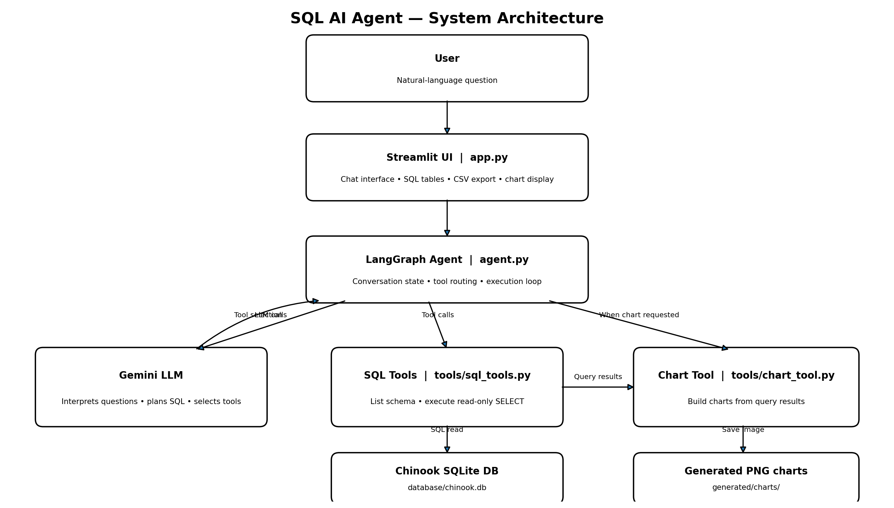
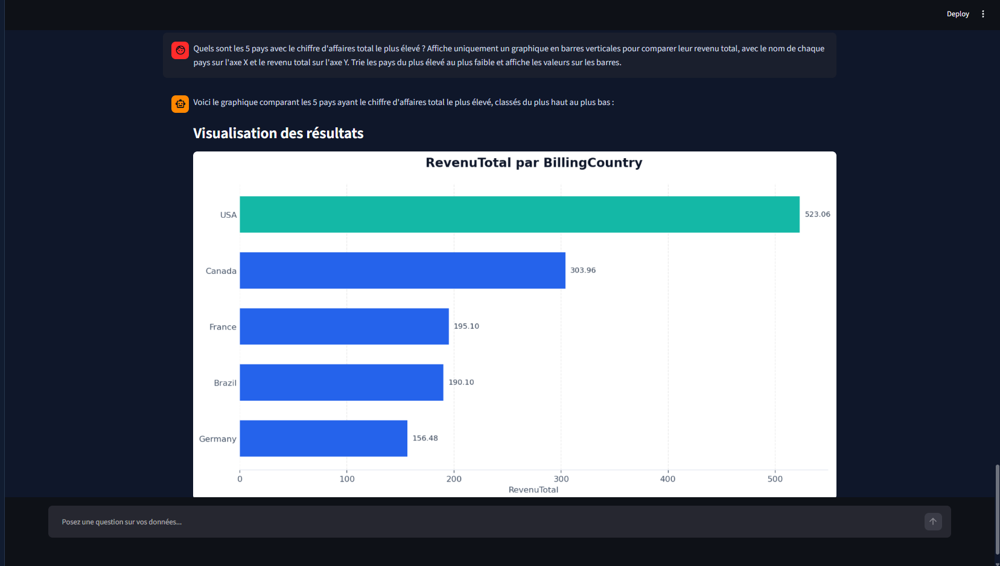

# SQL AI Agent

SQL AI Agent is a Python application that allows users to ask questions about a SQL database using natural language.

The project uses Google Gemini and LangGraph to understand questions, generate SQL queries, execute them, and display the results. It can also create charts to make data easier to understand.

The application uses the Chinook database, a sample database for a music store.

## Architecture



## Main features

- Ask questions about the database in natural language.
- Explore database tables and columns.
- Generate and execute SQL SELECT queries.
- Display query results in tables.
- Export results to CSV.
- Generate charts from query results.
- Use Gemini and LangGraph to manage the agent workflow.
- Run the application in DEMO mode or REAL mode.

## Example

For example, the user can ask:

**"Quels sont les 5 pays avec le chiffre d'affaires total le plus élevé ?"**

The agent generates the SQL query, retrieves the results, and creates a chart to compare the five countries.



## Technologies

- Python
- Google Gemini API
- LangChain
- LangGraph
- SQLite
- Streamlit
- Pandas
- Matplotlib
- uv

## Project structure

```text
SQL-AI-Agent/
├── app.py
├── agent.py
├── config.py
├── database/
│   ├── chinook.db
│   └── setup_db.py
├── tools/
│   ├── sql_tools.py
│   └── chart_tool.py
├── tests/
├── docs/
│   ├── architecture.png
│   └── screenshots/
│       └── top-5-countries-revenue.png
├── .env.example
├── .gitignore
├── pyproject.toml
├── uv.lock
└── README.md
```

## Installation

### 1. Clone the repository

```bash
git clone https://github.com/NeuralHamdi/SQL-AI-Agent.git
cd SQL-AI-Agent
```

### 2. Install dependencies

```bash
uv sync
```

### 3. Configure the API key

Create a `.env` file from `.env.example` and add your Gemini API key:

```env
GOOGLE_API_KEY=your_api_key
GEMINI_MODEL=your_model_name
DEMO_MODE=false
```

You can get an API key from Google AI Studio:

https://aistudio.google.com/apikey

### 4. Run the application

```bash
uv run streamlit run app.py
```

Open the local URL provided by Streamlit.

## Example questions

- Which countries generate the most revenue?
- Which customers have spent the most?
- Which artists have the highest sales?
- Which music genres are the most popular?
- How does revenue change over time?

## Tests

To run the tests:

```bash
uv run pytest
```

## Author

Ahmed Hamdi

Engineering Student in Big Data and Artificial Intelligence

GitHub: https://github.com/NeuralHamdi
